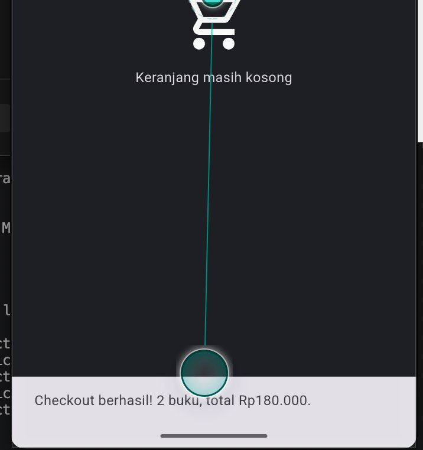
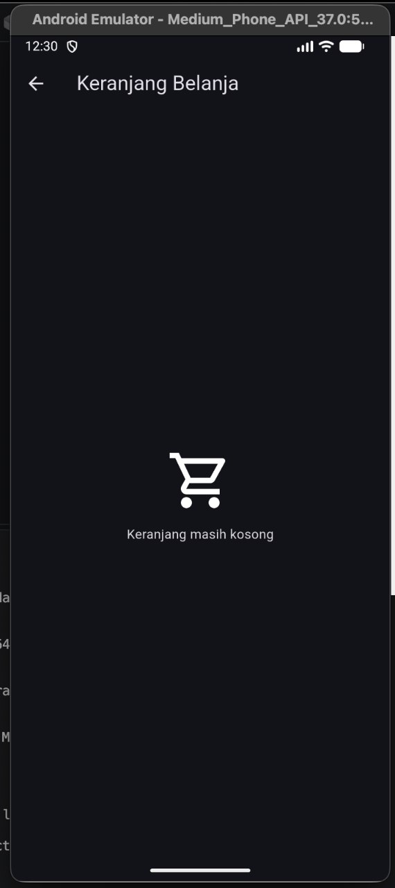
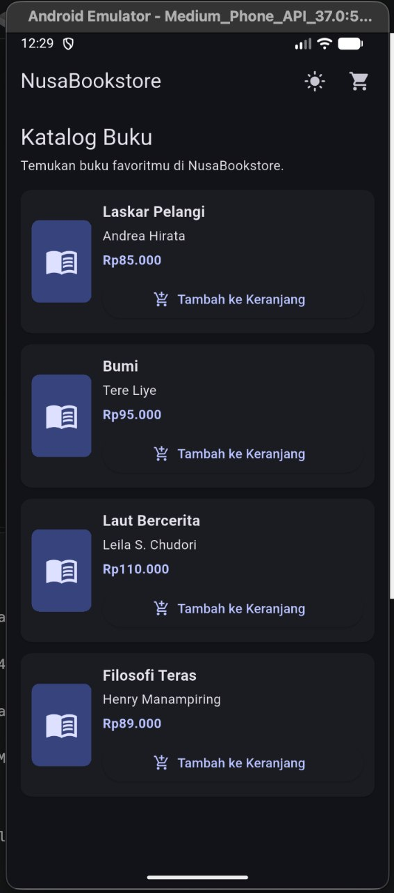
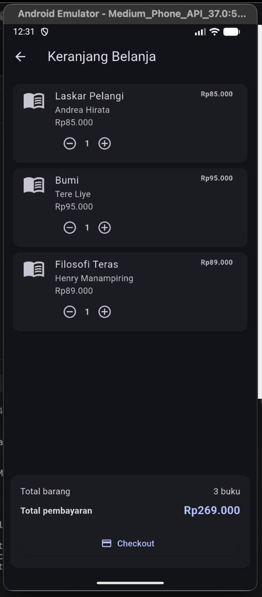
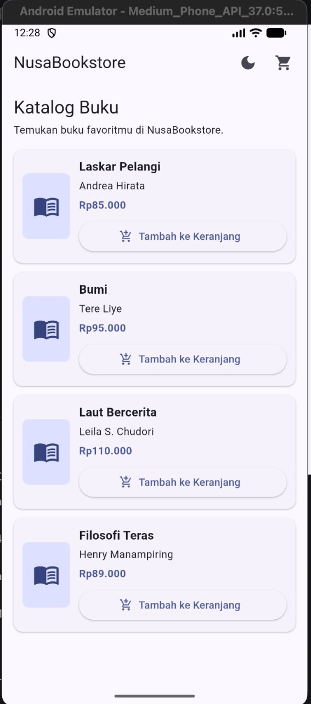

# tugas_sesi_3

# NusaBookstore — Tugas PPM Sesi 4

Aplikasi katalog dan keranjang belanja buku berbasis Flutter dengan state management menggunakan Provider.

## Identitas

- **Nama:** Fikri Zakaria
- **NIM:** 20240040067
- **Mata Kuliah:** Pemrograman Perangkat Mobile
- **Tugas:** Sesi 4 — State Management dengan Provider

## Fitur Aplikasi

- Katalog minimal empat buku.
- Menambahkan buku ke keranjang.
- Mengubah jumlah dan menghapus item keranjang.
- Badge jumlah item pada ikon keranjang.
- Perhitungan total harga secara reaktif.
- Light Mode dan Dark Mode.
- Checkout dengan notifikasi SnackBar dan pengosongan keranjang.

## Teknologi

- Flutter
- Dart
- Provider
- ChangeNotifier

## Struktur Project

- `lib/main.dart`
- `lib/models/book.dart`
- `lib/providers/cart_provider.dart`
- `lib/providers/theme_provider.dart`
- `lib/screens/catalog_screen.dart`
- `lib/screens/cart_screen.dart`

## Screenshot Aplikasi

